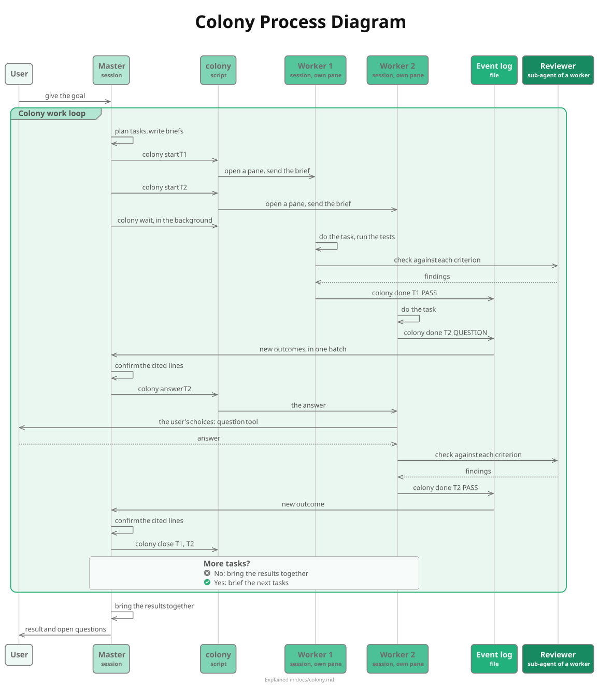

# Colony

Start here to understand the colony: what it is, why it exists, how it works
and why it works this way. The decisions, with
their evidence, are in
[Decisions and their reasons](#decisions-and-their-reasons) below.
Before 2026-10-06 a colony was called a pool, so older records and folder
names say "pool".

Diagram source: [`colony.puml`](colony.puml).

| Question | Section |
|---|---|
| What is it? | [What a colony is](#what-a-colony-is) |
| How is a worker different from a sub-agent? | [Workers are not sub-agents](#workers-are-not-sub-agents) |
| Why did we build it? | [The problem](#the-problem) |
| What does it solve? | [What the colony solves](#what-the-colony-solves) |
| How does it work? | [How work moves](#how-work-moves) |
| Why does it work this way? | [Decisions and their reasons](#decisions-and-their-reasons) |
| What does it rest on? | [Principles](#principles) |
| Which analogies is it built on? | [Principles](#principles), the analogy table |
| Did it work? | [Evidence](#evidence) |
| What is not solved? | [Limits and open questions](#limits-and-open-questions) |
| How do I change it? | [Changing the colony](#changing-the-colony) |
| Where are the details? | [Where to go next](#where-to-go-next) |

## What a colony is

A colony is one Master Claude Code session and the worker sessions it starts.
A worker is a separate Claude Code session in its own Herdr pane, not a
sub-agent; [Workers are not sub-agents](#workers-are-not-sub-agents) explains
the difference. Each worker does one task and then closes. The Master
plans, writes a brief for each task, decides, and checks results. The
`colony` command (`colony.py`) does the routine steps: it opens and closes
panes, starts workers and keeps an event log. Workers report their outcome to
that log in one line. The Master waits on the log in the background and wakes
once for each batch of outcomes.

The name was the user's choice on 2026-10-06. Ants coordinate through a shared
trail rather than by messages. Workers here coordinate through one event log.

### Terms

| Term | Meaning |
|---|---|
| Master | The session that plans, briefs, decides and confirms. One per colony |
| Worker | A separate Claude Code session, in its own Herdr pane, that does one task and then closes. Not a sub-agent |
| Task | One piece of work with an id, such as `T12` |
| Brief | The file that defines a task: goal, inputs, acceptance criteria, what the worker may decide alone, result file |
| Result file | Where the worker writes its result. A durable path, never a scratch folder |
| Outcome | What the worker reports: PASS, FAIL, BLOCKED or QUESTION |
| Event log | `events.log`: one line for each start, outcome, answer and close |
| Sub-agent | A helper inside one session, started by that session's Agent tool. Its result returns into that session's context |
| Reviewer | A read-only sub-agent that a worker starts to check its result |
| Checkpoint | The Master's state, written to a file before an opt-in restart |

## Workers are not sub-agents

A colony worker and a Claude Code sub-agent both work in a fresh context. They
differ in where that context lives, what flows back, and what each can do.

| | Sub-agent | Colony worker |
|---|---|---|
| What it is | A helper inside one session's process, started by its Agent tool | A separate Claude Code session in its own Herdr pane, started by `colony start` |
| First request | Median 25k tokens (measured on 400 sub-agent transcripts, 2026-10-06) | 38k tokens: a full session start (measured in the benchmark, 2026-10-06) |
| What flows back | Its final text enters the parent's context and is sent again with every later request there. A background sub-agent's result arrives as a task notification, median 6.0k characters, and starts a new turn in the parent (measured over 14 days to 2026-10-05) | One line of at most 300 characters in the event log. The full result stays in a file. `colony wait` returns a batch of outcomes in one wake |
| Can it ask the user? | No. Claude Code removes the question tool from sub-agents (Claude Code docs, sub-agents, available tools; read 2026-10-06) | Yes, with the question tool in its own pane |
| Tools | Nearly all; a background sub-agent gets a smaller built-in set (same docs page) | Everything a session has, including its own sub-agents |
| Visible to the user | As progress inside the parent's screen | In its own pane, where the user can watch and type |
| Lifetime | Ends when it returns its answer. It runs in the parent's process, so it cannot outlive the parent session (inferred) | Runs until its task is done; the Master closes it. It is a separate process, so the Master can compact or restart while workers go on |

Why a colony gives tasks to sessions rather than to sub-agents:

1. A sub-agent's result enters the Master's context and is paid for on every
   later request. A worker returns one line and a file path.
2. Each background sub-agent's result starts a new Master turn at full context.
   Before the colony, those turns cost 539M tokens in 14 days (measured),
   and handing checks to the Master's own sub-agents saved about nothing
   (estimated).
3. A worker on a long task often needs the user's decision. A sub-agent cannot
   ask.
4. Workers keep going while the Master compacts or restarts.

The two work together. Each worker uses a sub-agent as its reviewer, and a
Master still uses sub-agents for quick lookups. Rule of thumb: a question, a
search or a short bounded check goes to a sub-agent; a task with a deliverable,
such as a build or a verification, goes to a worker.

## The problem

From 2026-09-28 the user ran pools of long-lived sessions: a Master and
"Slave" sessions that took task after task. Daily use rose from under 0.6
billion tokens to between 1.4 and 3.6 billion (measured from transcripts).
On 2026-10-05 the weekly limit was 34%
used after about 23 hours (read by the user from `/usage`). Three problems
caused this, and one more made the pool hard to run.

1. Every request sends the whole context again. In the 14 days to
   2026-10-05, 14.60 of 14.86 billion tokens were cache reads (measured).
   So the cost of a step is about the size of the context that takes it.
2. Long-lived workers carried every earlier task. A worker began a new
   task at a median of 651k tokens of context, against 29k to 46k for a new
   session (measured, 271 task turns). That carried history was 2.9 to 3.7
   billion tokens, 32% to 41% of all pool tokens (estimated).
3. The Master handled every event at full size. Masters used 31% of
   pool tokens, and 63% of that was in requests over 600k (measured). A
   worker's report started a Master turn of a median of 3 requests at 564k
   (measured, 256 turns).
4. Coordination by message failed. On 2026-09-30 five sessions in one
   folder lost relays, let messages expire, missed arrivals and sent
   questions to the wrong session (read from those sessions' notes). A session in bypass mode holds a message from a session that is not,
   and drops it after five minutes (Claude Code docs). The user also had to
   open, close and track panes by hand.

The figures for 2 and 3 come from 9,034M pool tokens in the 14 days to
2026-10-05.

## What the colony solves

| Problem | What the colony does |
|---|---|
| Workers carry old tasks | A new worker for each task. It starts at about 38k tokens (measured, 2026-10-06) |
| The Master works at full size for each event | The worker checks its own result in its own small context. The Master confirms only the lines the report cites |
| Each event starts a Master turn | `colony wait` returns all new outcomes in one batch. A passing worker reports one line |
| Messages are held, dropped or misrouted | Outcomes go to a file, not through messages. Nothing can expire |
| Routine steps cost Master requests | One `colony` command for each routine step |
| Panes are managed by hand | `colony start` opens a pane and `colony close` closes it |
| Long Masters lose detail or cost much | Masters compact at 600k, earlier than other sessions (800k). Opt-in: the Master writes a checkpoint and restarts from it |

The colony does not reduce the work or its quality. The thinking effort, the
review of each result, the Master's own fact checks, and questions going to the
user all stay the same. Each brief pins a worker model and an effort, so a
worker runs the cheapest model that can pass its task. The reviewer runs
`reviewer_model` (`claude-opus-4-8`). The policy is in `colony-models.json`.

## How work moves

Start a Master with `CLAUDE_CODE_AUTO_COMPACT_WINDOW=600000 claude`, and resume
one with the same prefix before `claude --resume <id>`. Without it, the Master
compacts at 800k like other sessions, and `colony start` warns.

The diagram at the top shows two tasks, one of which asks a question. For one task, in words:

1. Brief: the Master runs `colony brief T1`, which writes a template, and
   fills in its five sections. The acceptance criteria say in advance what a
   correct result looks like. "You may decide" says what the worker can settle
   without asking.
   The Model and Effort sections are required. The Model names a pinned model
   id from `worker_models` in `colony-models.json`. A bare alias (`opus`,
   `sonnet`, `haiku`) is refused, because an alias floats to the newest model,
   which may be banned or costlier. The Effort is one of `low`, `medium`,
   `high`, `xhigh`, `max`. The Master picks the cheapest model and effort that
   can pass the task.
2. Start: `colony start T1 <brief>` refuses a brief that lacks a section
   or still holds template text. It also refuses a brief whose Model or Effort
   is missing or not in the config, even under `--no-check`. It opens a pane
   beside the Master (later workers stack below the first) and starts Claude
   there on the brief's model and effort. Then it sends the worker prompt.
   `--model` and `--effort` override the brief and are validated the same way.
   The brief's
   model and effort go into the task JSON and the STARTED event, and
   `colony report` shows them. The prompt names the brief and the steps the
   worker must follow.
3. Wait: the Master runs `colony wait` in the background and ends its
   turn. It uses no tokens while it waits.
4. Questions: for a decision outside the brief, the worker runs
   `colony done T1 QUESTION`, and the Master replies with `colony answer`. A
   choice that is the user's goes to the user, with the question tool, in the
   worker's pane.
5. Check: the worker runs the tests that apply. Then one read-only
   reviewer sub-agent, on `reviewer_model` (`claude-opus-4-8`) and with a new
   context, checks the result against each criterion, in at most 12 tool calls.
   The worker fixes what it finds.
6. Report: the worker writes the result file, saves to memory any
   project fact the next worker needs, and runs one `colony done`: PASS with
   the lines to confirm, FAIL with the failed criterion, or BLOCKED.
7. Confirm: `colony wait` returns every new outcome. For a PASS, the Master
   checks the cited lines itself, with one search and one bounded read.
8. Close: `colony close T1` records the worker's session ID and closes the
   pane. The transcript stays and can be resumed.

`colony wait` also reports a worker whose pane is gone (LOST) and one that
stopped without reporting (IDLE). `colony report` counts tokens per worker and
for the Master. `colony status` shows one line per task.

### Outcomes and events

| Event | Written by | Wakes the Master |
|---|---|---|
| STARTED | `colony start` | no |
| START-FAILED | `colony start`, when Herdr fails | yes |
| QUESTION, PASS, FAIL, BLOCKED | the worker | yes |
| ANSWERED | `colony answer` | no |
| LOST, IDLE | `colony wait` | yes |
| CLOSED | `colony close` | no |
| RESTART | `colony restart` | no |

### Where things are

State lives outside the project, so a colony changes no project file:
`~/.local/state/claude-system/colony/<project path>/<colony name>/` holds
`events.log`, `tasks/`, `briefs/`, `results/`, `colony.json` (the Master's
pane and sessions), `master.md` (the checkpoint) and `wait.offset` (how far the
Master has read). `COLONY_NAME` (default `main`) keeps several colonies in one
project apart; workers inherit it.

## Decisions and their reasons

| Decision | Reason | Considered instead | Record |
|---|---|---|---|
| A new worker for each task | The largest measured cost was workers carrying old tasks | Long-lived workers, as before; clearing a worker between tasks | the design decision, 2026-10-05 |
| Outcomes in a file, read by a background wait | Messages between sessions were held, expired or misrouted; a file cannot expire. One wait can return several outcomes | A message per result (the 2026-10-05 rule); accepting all inbound messages machine-wide, which the user declined for safety | the design decision, 2026-10-06 |
| A script for each routine step | Run as separate tool calls at about 545k context, the Herdr steps would add about 0.6 billion tokens in 14 days (estimated) | The Master runs Herdr commands itself | the design decision, 2026-10-06 |
| The worker checks its own result | Checking in the Master costs Master-size requests (650M in report turns, measured). A background sub-agent in the Master starts one more Master turn for its result, so the earlier router idea saved about nothing (estimated) | The Master checks; the Master hands checks to its own sub-agent | measured |
| A bounded reviewer, not a staff review | Unbounded review runs averaged 5M tokens; a bounded one costs much less | No review; a staff review per task | measured |
| A brief with five fixed sections | Fixed fields leave less room for doubt and let a passing worker report one line. Anthropic's research system found that vague briefs cause duplicated work and gaps | Free-text briefs | Anthropic research |
| The Master confirms cited lines | A report from another agent is a pointer, not the source | Trust the worker's PASS | the design principle |
| The Master restart is opt-in | It saves context, but the Master loses its conversation history, which the user values | Auto-compact the Master below 600k | the design decision |
| Masters compact at 600k, other sessions at 800k | Every Master request carries its context, and its state lives in files (plan, ledger, event log, briefs). Other sessions keep more detail, at about 30% more tokens per hour once past 600k (estimated) | One window for every session; Masters at 200k | the design decision, 2026-10-06 |
| Every brief pins a model and an effort; the policy lives in `colony-models.json`, and Opus 5.5 and Fable are banned | Opus 5.5 drained the user's tokens, so each worker should run the cheapest model that can pass. A pinned id, not a floating alias, keeps a worker off a banned or costlier model. One config file holds the policy, for a fork to set its own. Tests and an Opus 4.8 reviewer catch a cheaper worker's mistakes | A bare `opus` default; the Master picks any model; a hardcoded policy in the code | the design decision, 2026-10-08 |
| Workers are sessions, not sub-agents | A sub-agent's result enters the Master's context, a background one starts a Master turn, and a sub-agent cannot ask the user (see [Workers are not sub-agents](#workers-are-not-sub-agents)) | Sub-agents started by the Master's Agent tool, in the foreground or the background | this page |
| Herdr panes | The user works in Herdr, and a worker can ask the user in its own pane | Agent teams: experimental and they cannot use Herdr panes. Headless `claude -p`: cannot ask the user and is not visible. OpenRig: did not meet the requirements | the OpenRig spike |
| State outside the project | The colony must not change project files; each project decides its own ledger | A ledger file in each repo | the design decision |
| No mods | A mod could drop status messages before the model sees them, but mods are not sandboxed | A `session.receive` mod | the design decision |

## Principles

The design follows one cost model: tokens ≈ events × requests per event ×
the context size of the session that handles each event, plus each message's
size × the requests that carry it later. Each mechanism lowers one of these
four factors. Each mechanism borrows a principle from another field.

| What the colony does                                  | Analogy                                                             | From                          | In plain words                                                                                                                                                                                                                      |
| ----------------------------------------------------- | ------------------------------------------------------------------- | ----------------------------- | ----------------------------------------------------------------------------------------------------------------------------------------------------------------------------------------------------------------------------------- |
| A new worker for each task                            | Working set (Denning, 1968)                                         | operating systems             | Fast memory should hold only what the current job uses. Context is the expensive memory, because it is sent again with every request, so a worker holds one task and nothing older                                                  |
| The worker closes; only its result reaches the Master | Generational garbage collection (Ungar, 1984)                       | programming languages         | Most data dies young, so collectors keep new data in a small nursery and promote only what survives. Workers are the nursery: searches, logs and test output close with them, and only the conclusion reaches the long-lived Master |
| The event log, instead of messages                    | Stigmergy (Grassé, 1959); the blackboard pattern (Hearsay-II, 1980) | biology, early AI             | Ants coordinate through a trail that others read, not by talking. Workers write to one shared log instead of messaging the Master, so nothing is lost or expires. The name "colony" comes from this                                 |
| `colony wait` wakes the Master once for many outcomes | Interrupts and batching (Linux NAPI; Nagle, RFC 896)                | hardware, networking          | Wake when something happens instead of checking again and again, and handle several events in one wake                                                                                                                              |
| The `colony` script does the routine steps            | Reflex arc                                                          | biology                       | A spinal reflex handles a routine signal without the brain. The script opens panes and writes the log without the Master's costly requests                                                                                          |
| A brief with acceptance criteria; a PASS is one line  | Predictive coding (Rao and Ballard, 1999); management by exception  | neuroscience, management      | Higher brain areas receive only what was not predicted. When the result matches the criteria, one line is enough; detail comes only with a failure                                                                                  |
| The worker tests and reviews its own result           | Jidoka (Toyota)                                                     | manufacturing                 | A machine stops itself on a defect, so quality is fixed where the work happens: in the worker's small context, not in the Master                                                                                                    |
| "You may decide" in the brief                         | Lease (Gray and Cheriton, 1989); mission command                    | distributed systems, military | Authority is granted in advance and within bounds, so no question is needed inside them                                                                                                                                             |
| The brief template and project memory                 | Shared dictionary (Brotli, RFC 7932)                                | compression                   | Shared knowledge is sent once; each message carries only what is new                                                                                                                                                                |
| The Master checkpoint and restart                     | Log compaction with snapshots (Raft, 2014)                          | distributed databases         | A system saves a snapshot of its state and starts from it, instead of replaying a log that keeps growing. A long Master conversation is such a log                                                                                  |

Stigmergy is behind the event log, and Raft is behind the checkpoint and
restart.

Two rules hold over all of these: the user decides the user's questions, and
the Master checks facts at their source.

## Evidence

| Run | Date | Result | Ground |
|---|---|---|---|
| LIVE1: one worker, one-step task | 2026-10-06 | Every step worked. 5 requests, 194k tokens | measured |
| Benchmark: a new Master and three parallel workers on a research question | 2026-10-06 | Every step worked, including a question, three PASS outcomes, the Master's checks and a restart. 291 requests, 37.8M tokens, about 130k a request. Workers started at 38k | measured |
| The same 291 requests at the old median context sizes | 2026-10-06 | About 185M tokens, about 5 times as much | estimated, same benchmark |
| Tests | 2026-10-08 | 95 cases pass against a fake Herdr | `bash tests/colony.sh` |

The benchmark found two faults in `colony report`, both fixed: it undercounted
output tokens, and it missed the Master's session after a restart.

## Limits and open questions

- Only a research task was benchmarked. A coding task with tests was not.
- The effect of a cheaper worker model on the plan limits is not measured yet.
  `colony report` shows each worker's model and effort.
- Savings are counted in raw tokens. How the plan limits weigh cache reads
  against other tokens is not published; outside reports range from 0 to 1
  times a fresh input token.
  Report savings both raw and weighted by API price.
- A background command stops after 30 minutes unless its Bash call sets a
  longer timeout (Claude Code 2.1.287). `colony wait` stops at 1,700 seconds
  by default, and the Master runs it again.
- Unverified: whether `colony wait` reports a worker that waits on the
  question tool as IDLE.
- One reader per colony: only the Master runs `colony wait`.
- A Master outside Herdr cannot run a colony.
- Workers start in the permission mode from settings, `bypassPermissions`.

## Changing the colony

The colony serves every project. A change to it needs evidence from more than one
project, or must cost nothing where the problem does not occur. A fix for one
project's problem goes into that project's briefs or its Master instead. The
user set this on 2026-10-07.

| What changes | Where | What else to do |
|---|---|---|
| Behaviour of a command | `colony.py` | Add a case to `tests/colony.sh`, see it fail first, then pass |
| The worker prompt, brief template or checkpoint text (`PROMPT`, `BRIEF_TEMPLATE`, `CHECKPOINT_TEMPLATE`, `RESUME_PROMPT`) | `colony.py` | Use your own review process before changing text that steers workers, then get the user's approval |
| The worker model policy | `colony-models.json` | Edit the config, not the code; `COLONY_MODELS_CONFIG` overrides its path |
| A design decision | A new dated section in the History table below | Update this page and its decision table |
| The flow | `docs/colony.puml` | Re-render with `plantuml -tsvg docs/colony.puml` |

`colony-models.json`, read by `models_config()` in `colony.py`, holds
the model policy, so a fork sets its own in one file. Its keys are:

- `worker_models`: the pinned ids a brief may name (`claude-opus-5`,
  `claude-opus-4-8`, `claude-sonnet-5`, `claude-sonnet-5-5`,
  `claude-haiku-4-5-20251001`);
- `banned`: `claude-opus-5-5` and `claude-fable-5-1`;
- `master_model` and `reviewer_model`: both `claude-opus-4-8`;
- `efforts`: `low`, `medium`, `high`, `xhigh`, `max`.

It is read through the real script path, so it works through the
`~/.local/bin/colony` symlink; `COLONY_MODELS_CONFIG` overrides the path.

After any change, update this page and the diagrams in the same piece of
work.

### History

| Date | Change | Ground |
|---|---|---|
| 2026-09-28 | Pools of long-lived sessions begin | measured rise in daily tokens |
| 2026-09-30 | Rules for working across sessions; OpenRig not adopted | the design decision |
| 2026-10-05 | A new worker for each task, in a Herdr pane | the design decision |
| 2026-10-06 | The `colony` command; briefs, self-checks, answer, report, separate colonies and the opt-in restart; benchmark; this page | the design decision |
| 2026-10-06 | A brief can choose Sonnet for a mechanical task; the reviewer stays on Opus | the design decision |
| 2026-10-06 | Workers named as sessions, not sub-agents; bounded checks go to sub-agents and verification tasks to workers | the design decision |
| 2026-10-06 | Masters compact at 600k, other sessions at 800k; `colony start` warns when the Master lacks the setting | the design decision |
| 2026-10-07 | A brief-template line for a later verifier's checks, added and reverted the same day: its evidence came from one project | the design decision |
| 2026-10-08 | A brief may pin Opus 4.8 with `claude-opus-4-8`; `opus` still means the newest Opus | the design decision |
| 2026-10-08 | Every brief pins a model and an effort; the policy moves to `colony-models.json`; bare aliases dropped; Opus 5.5 and Fable banned; the reviewer runs `claude-opus-4-8` | the design decision |

## Where to go next

| To understand | Read |
|---|---|
| The colony process, step by step | [`colony.svg`](colony.svg) |
| The decisions and their evidence | [Decisions and their reasons](#decisions-and-their-reasons) |
| The auto-compact windows: 800k for sessions, 600k for Masters | [Decisions and their reasons](#decisions-and-their-reasons) |
| The code and tests | [`../colony.py`](../colony.py), [`../tests/colony.sh`](../tests/colony.sh) |
