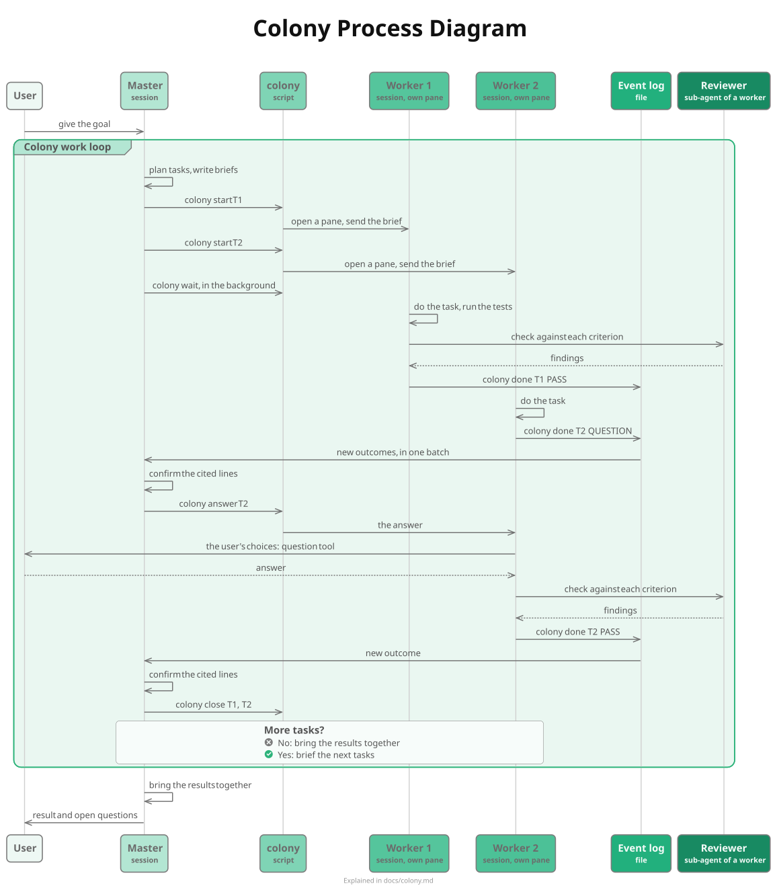

# Colony

Start here to understand the colony: what it is, why it exists, how it works
and why it works this way. The decisions, with
their evidence, are in
[Decisions and their reasons](#decisions-and-their-reasons) below.
Before 2026-10-06 a colony was called a pool, so older records and folder
names say "pool".

Diagram source: [`colony.puml`](colony.puml).

| Question | Section |
|---|---|
| What is it? | [What a colony is](#what-a-colony-is) |
| How is a worker different from a sub-agent? | [Workers are not sub-agents](#workers-are-not-sub-agents) |
| Why did we build it? | [The problem](#the-problem) |
| What does it solve? | [What the colony solves](#what-the-colony-solves) |
| How does it work? | [How work moves](#how-work-moves) |
| Why does it work this way? | [Decisions and their reasons](#decisions-and-their-reasons) |
| What does it rest on? | [Principles](#principles) |
| Which analogies is it built on? | [Principles](#principles), the analogy table |
| Did it work? | [Evidence](#evidence) |
| What is not solved? | [Limits and open questions](#limits-and-open-questions) |
| How do I change it? | [Changing the colony](#changing-the-colony) |
| Where are the details? | [Where to go next](#where-to-go-next) |
| What if I don't have Herdr? | [colonybg: the no-Herdr backend](#colonybg-the-no-herdr-backend) |

## What a colony is

A colony is one Master Claude Code session and the worker sessions it starts.
A worker is a separate Claude Code session in its own Herdr pane, not a
sub-agent; [Workers are not sub-agents](#workers-are-not-sub-agents) explains
the difference. Each worker does one task and then closes. The Master
plans, writes a brief for each task, decides, and checks results. The
`colony` command (`colony.py`) does the routine steps: it opens and closes
panes, starts workers and keeps an event log. Workers report their outcome to
that log in one line. The Master waits on the log in the background and wakes
once for each batch of outcomes.

The name was the user's choice on 2026-10-06. Ants coordinate through a shared
trail rather than by messages. Workers here coordinate through one event log.

### Terms

| Term | Meaning |
|---|---|
| Master | The session that plans, briefs, decides and confirms. One per colony |
| Worker | A separate Claude Code session, in its own Herdr pane, that does one task and then closes. Not a sub-agent |
| Task | One piece of work with an id, such as `T12` |
| Brief | The file that defines a task: goal, inputs, acceptance criteria, what the worker may decide alone, result file |
| Result file | Where the worker writes its result. A durable path, never a scratch folder |
| Outcome | What the worker reports: PASS, FAIL, BLOCKED or QUESTION |
| Event log | `events.log`: one line for each start, outcome, answer and close |
| Sub-agent | A helper inside one session, started by that session's Agent tool. Its result returns into that session's context |
| Reviewer | A read-only sub-agent that a worker starts to check its result |
| Checkpoint | The Master's state, written to a file before an opt-in restart |
| Verdict | What the Master made of a result: accept, reject or partial. Recorded by `colony close`, and unset until then. Not the same as the worker's outcome |

## Workers are not sub-agents

A colony worker and a Claude Code sub-agent both work in a fresh context. They
differ in where that context lives, what flows back, and what each can do.

| | Sub-agent | Colony worker |
|---|---|---|
| What it is | A helper inside one session's process, started by its Agent tool | A separate Claude Code session in its own Herdr pane, started by `colony start` |
| First request | Median 25k tokens (measured on 400 sub-agent transcripts, 2026-10-06) | 38k tokens: a full session start (measured in the benchmark, 2026-10-06) |
| What flows back | Its final text enters the parent's context and is sent again with every later request there. A background sub-agent's result arrives as a task notification, median 6.0k characters, and starts a new turn in the parent (measured over 14 days to 2026-10-05) | One line of at most 300 characters in the event log. The full result stays in a file. `colony wait` returns a batch of outcomes in one wake |
| Can it ask the user? | No. Claude Code removes the question tool from sub-agents (Claude Code docs, sub-agents, available tools; read 2026-10-06) | Yes, with the question tool in its own pane |
| Tools | Nearly all; a background sub-agent gets a smaller built-in set (same docs page) | Everything a session has, including its own sub-agents |
| Visible to the user | As progress inside the parent's screen | In its own pane, where the user can watch and type |
| Lifetime | Ends when it returns its answer. It runs in the parent's process, so it cannot outlive the parent session (inferred) | Runs until its task is done; the Master closes it. It is a separate process, so the Master can compact or restart while workers go on |

Why a colony gives tasks to sessions rather than to sub-agents:

1. A sub-agent's result enters the Master's context and is paid for on every
   later request. A worker returns one line and a file path.
2. Each background sub-agent's result starts a new Master turn at full context.
   Before the colony, those turns cost 539M tokens in 14 days (measured),
   and handing checks to the Master's own sub-agents saved about nothing
   (estimated).
3. A worker on a long task often needs the user's decision. A sub-agent cannot
   ask.
4. Workers keep going while the Master compacts or restarts.

The two work together. Each worker uses a sub-agent as its reviewer, and a
Master still uses sub-agents for quick lookups. Rule of thumb: a question, a
search or a short bounded check goes to a sub-agent; a task with a deliverable,
such as a build or a verification, goes to a worker.

## colonybg: the no-Herdr backend

`colony` needs Herdr. A worker is a Herdr pane. `herdr agent start` starts
it, `herdr agent prompt` drives it, `herdr agent get` finds it idle or gone.
`colonybg` is the same Master/worker/brief/event-log design with no Herdr
call anywhere in it. A worker is a `claude --bg` background session instead
of a pane.

Everything that is not about starting, driving or checking a worker is one
shared module, `colony_core.py`: briefs, the event log, the retrieval hook,
worktrees, and `colony report`'s usage pipeline. Neither tool's backend code
imports the other's.

`colonybg status`, `colonybg report` and a worker's own `colony done` call
run the exact same code `colony` does. Either tool's `status` and `report`
read a colony that the other tool started. `answer` and `close` need the tool
that started the worker, because only that tool can stop the worker. The
other tool refuses and names the right one. Both key their state the same way
(`COLONY_HOME`, `COLONY_NAME`, `COLONY_ROOT`), not by which backend holds the
pane.

The backend swap is not free. Three things `colony` gets from Herdr's live
pane control have no Herdr-free equivalent yet, checked against the real
`claude` CLI rather than assumed:

- **No live pane write.** `herdr agent prompt` can deliver a second prompt to
  a worker's pane while it is still running. `claude --resume` cannot. Tried
  against a session that was still running, idle or busy, it forked a copy
  instead of continuing it in place. `colonybg answer` and `colonybg close`
  stop the worker first (`claude stop`, which keeps its conversation), then
  act. Answering a worker is a stop-and-resume, not a live interruption.
  `claude stop`, `logs` and `attach` take only the short id that `claude
  --bg` prints. Given the full session id, they print "No job matching".
  So a task keeps both ids. The short id stops and reads the worker. The
  full id resumes it and finds its transcript for `report`. After a stop,
  `colonybg` reads `claude agents`. It does not answer or close a worker
  that still has a live process.
- **No self-restart.** `colony restart` injects `/clear` and a resume prompt
  into the Master's own Herdr pane, from the Master's own running tool call.
  A Master that stopped itself could not then start its replacement. So
  `colonybg restart --confirm` writes a request file, for a separate
  `colonybg watchdog` process to pick up. The watchdog stops the Master by
  its short id and checks that it stopped. Then it starts a new background
  Master in the same folder with a prompt that names the checkpoint. The new
  session has a clear context, and the watchdog records its id. Resuming the
  old session with `/clear` does not work, checked live. The resume leaves
  the session running, so the next resume starts a copy with the old
  context. Also, `/clear` gives the session a new id. The new Master runs on
  the default model, because `claude agents` does not show the old one's
  model. `colonybg restart` refuses unless the Master's own session is a
  `claude --bg` session. Run `colonybg watchdog` once per colony: it loops,
  and Ctrl-C stops it and removes its pid file. Or trigger `colonybg
  watchdog --once` yourself on a schedule.
- **No confirmed "waiting for the user" signal.** `herdr pane get` reports
  `agent_status: blocked` while a worker's own question tool waits for the
  user. That is how `colony wait` tells "waiting" apart from "idle, maybe
  stopped" before counting IDLE_SAMPLES. In `claude agents --json --all`, a
  running session has a pid and a status, `idle` or `busy`, checked live. A
  session that exited or was stopped keeps its row with no pid and no
  status. Its state is `done`, `stopped` or `failed`, and `colonybg wait`
  reports that worker LOST. There is no confirmed state for a
  worker parked on its own question tool with no terminal attached. A
  `colonybg` worker that asks the user may be reported IDLE while it waits,
  same as any other idle worker. Not yet resolved; see
  [Limits and open questions](#limits-and-open-questions).
- **Trust.** `claude --bg` refuses a folder that is not trusted, and it
  shows no prompt to accept. Checked live: a Git repository must be trusted
  itself, and the trust of a parent folder does not reach it. A worktree
  takes the trust of its repository, so `colonybg start --worktree` works in
  a trusted project. Open the project with `claude` once before you run
  `colonybg` there.

## The problem

From 2026-09-28 the user ran pools of long-lived sessions: a Master and
"Slave" sessions that took task after task. Daily use rose from under 0.6
billion tokens to between 1.4 and 3.6 billion (measured from transcripts).
On 2026-10-05 the weekly limit was 34%
used after about 23 hours (read by the user from `/usage`). Three problems
caused this, and one more made the pool hard to run.

1. Every request sends the whole context again. In the 14 days to
   2026-10-05, 14.60 of 14.86 billion tokens were cache reads (measured).
   So the cost of a step is about the size of the context that takes it.
2. Long-lived workers carried every earlier task. A worker began a new
   task at a median of 651k tokens of context, against 29k to 46k for a new
   session (measured, 271 task turns). That carried history was 2.9 to 3.7
   billion tokens, 32% to 41% of all pool tokens (estimated).
3. The Master handled every event at full size. Masters used 31% of
   pool tokens, and 63% of that was in requests over 600k (measured). A
   worker's report started a Master turn of a median of 3 requests at 564k
   (measured, 256 turns).
4. Coordination by message failed. On 2026-09-30 five sessions in one
   folder lost relays, let messages expire, missed arrivals and sent
   questions to the wrong session (read from those sessions' notes). A session in bypass mode holds a message from a session that is not,
   and drops it after five minutes (Claude Code docs). The user also had to
   open, close and track panes by hand.

The figures for 2 and 3 come from 9,034M pool tokens in the 14 days to
2026-10-05.

## What the colony solves

| Problem | What the colony does |
|---|---|
| Workers carry old tasks | A new worker for each task. It starts at about 38k tokens (measured, 2026-10-06) |
| The Master works at full size for each event | The worker checks its own result in its own small context. The Master confirms only the lines the report cites |
| Each event starts a Master turn | `colony wait` returns all new outcomes in one batch. A passing worker reports one line |
| Messages are held, dropped or misrouted | Outcomes go to a file, not through messages. Nothing can expire |
| Routine steps cost Master requests | One `colony` command for each routine step |
| Panes are managed by hand | `colony start` opens a pane and `colony close` closes it |
| Long Masters lose detail or cost much | Masters compact at 400k, the window every session uses. Opt-in: the Master writes a checkpoint and restarts from it |

The colony does not reduce the work or its quality. The thinking effort, the
review of each result, the Master's own fact checks, and questions going to the
user all stay the same. Each brief pins a worker model and an effort, so a
worker runs the cheapest model that can pass its task. The policy is in
`colony-models.json`. A sub-agent's model is an alias from `subagent_models`,
because the Agent tool takes no pinned id. The reviewer asks for `opus`, the
explorer for `sonnet`.

## How work moves

Start a Master with `CLAUDE_CODE_AUTO_COMPACT_WINDOW=400000 claude`, and resume
one with the same prefix before `claude --resume <id>`. The prefix sets the
window whatever the settings file in use holds, and `colony start` warns without
it.

The diagram at the top shows two tasks, one of which asks a question. For one task, in words:

1. Brief: the Master runs `colony brief T1`, which writes a template, and
   fills in its sections. The acceptance criteria say in advance what a
   correct result looks like. "Owns" names the paths this worker may change,
   and `colony start` refuses a path an open task already owns. "You may
   decide" says what the worker can settle without asking.
   The Model and Effort sections are required. The Model names a pinned model
   id from `worker_models` in `colony-models.json`. A bare alias (`opus`,
   `sonnet`, `haiku`) is refused, because an alias floats to the newest model,
   which may be banned or costlier. The Effort is one of `low`, `medium`,
   `high`, `xhigh`, `max`. The Master picks the cheapest model and effort that
   can pass the task.
2. Start: `colony start T1 <brief>` refuses a brief that lacks a section
   or still holds template text. It also refuses a brief whose Model or Effort
   is missing or not in the config, even under `--no-check`. It opens a pane
   beside the Master (later workers stack below the first) and starts Claude
   there on the brief's model and effort. Then it sends the worker prompt.
   `--model` and `--effort` override the brief and are validated the same way.
   If Herdr reports the agent as not ready, `colony start` waits for it to
   report a session before giving up; see the limits below.
   It also names the directories holding the brief and the state with
   `--add-dir`, so the worker can read its brief without being asked.
   The brief's
   model and effort go into the task JSON and the STARTED event, and
   `colony report` shows them. The prompt names the brief and the steps the
   worker must follow.
3. Wait: the Master runs `colony wait` in the background and ends its
   turn. It uses no tokens while it waits.
4. Questions: for a decision outside the brief, the worker runs
   `colony done T1 QUESTION`, and the Master replies with `colony answer`. A
   choice that is the user's goes to the user, with the question tool, in the
   worker's pane.
5. Check: the worker runs the tests that apply. Then one read-only
   reviewer sub-agent, with a new context, checks the result against each
   criterion, in at most 12 tool calls. The worker fixes what it finds. The
   prompt asks for `subagent_models.reviewer`, the alias `opus`.
6. Report: the worker writes the result file, saves to memory any
   project fact the next worker needs, and runs one `colony done`: PASS with
   the lines to confirm, FAIL with the failed criterion, or BLOCKED.
7. Confirm: `colony wait` returns every new outcome. For a PASS, the Master
   checks the cited lines itself, with one search and one bounded read.
8. Close: `colony close T1` records the worker's session ID and closes the
   pane. The transcript stays and can be resumed. `--accept`, `--reject` or
   `--partial` records the Master's verdict on the result; without one the
   verdict stays unset. A task that retries another names it at the start:
   `colony start T2 <brief> --retry-of T1`.

`colony wait` also reports a worker whose pane is gone (LOST) and one that
every check in a row finds idle (IDLE). A worker is idle between turns, while
the Master answers a QUESTION, and while its own question tool waits for the
user. So IDLE needs three checks in a row and a pane that is not waiting for
input. `COLONY_IDLE_SAMPLES` sets how many checks. `colony status` shows one
line per task.
`colony report` counts tokens per worker and for the Master; the next section
says what it measures.

### What `colony report` measures

`colony report` reads each session's transcript and counts one row per worker
and per Master session. The first table is the one it always had: requests,
tokens, the first request's context, sub-agent tokens and minutes. Below it
come four more blocks:

- where the tokens went: input, output, thinking, cache reads, and cache writes
  split into their 5-minute and 1-hour kinds;
- one row per sub-agent, with the agent type and description from its
  `agent-<id>.meta.json`;
- the efforts the requests ran at, as served and per turn;
- notes: the model a brief pinned against the model that served it, the fields
  the transcripts do not carry, and the models with no price.

`colony report --json` prints the same report as data, with `null` where a
source has no value.

A response appears several times in a transcript while it streams. Within one
message and request id the input and cache counts stay the same. The output and
thinking counts only grow. So each response counts once, with its largest
output. Thinking tokens are part of output, not an addition to it. The
1-hour and 5-minute split belongs to cache writes; cache reads carry no such
split and the report invents none.

Three things the transcripts do not give:

- `requestedModel` is on 910 of 31,318 archived responses, so what was asked
  for is usually unavailable. The report compares the brief's pinned model with
  the model that served the requests instead.
- No agent type is called "reviewer", so a worker's bounded reviewer cannot be
  told apart from its other sub-agents. The report prints each sub-agent's type
  and description and leaves the reading to you.
- 2,094 of 31,318 responses carry no thinking field. There thinking is missing,
  not zero, and the report says so.

A cost needs rates. `colony-models.json` holds an optional `pricing` block, and
colony ships it empty: fill it from the vendor's current price list. A model is
priced only when every category it used has a rate, so the report shows no cost
rather than a low one.

### Outcomes and events

| Event | Written by | Wakes the Master |
|---|---|---|
| STARTED | `colony start` | no |
| START-FAILED | `colony start`, when Herdr fails | yes |
| QUESTION, PASS, FAIL, BLOCKED | the worker | yes |
| ANSWERED | `colony answer` | no |
| LOST, IDLE | `colony wait` | yes |
| CLOSED | `colony close` | no |
| RESTART | `colony restart` | no |

### Where things are

State lives outside the project, so a colony changes no project file:
`~/.local/state/claude-system/colony/<project path>/<colony name>/` holds
`events.log`, `tasks/`, `briefs/`, `results/`, `colony.json` (the Master's
pane and sessions), `master.md` (the checkpoint) and `wait.offset` (how far the
Master has read). `COLONY_NAME` (default `main`) keeps several colonies in one
project apart; workers inherit it.

### Task state

`tasks/<id>.json` holds what colony knows about one task: its id, agent, pane,
brief, model, effort, working directory, and start and close times. It also
holds the worker's session id. Four more fields record what nothing can
reconstruct later.

| Field | Written by | Meaning |
|---|---|---|
| `revision` | `colony start` | The committed HEAD of the project root when the task started, or `null` |
| `dirty` | `colony start` | Whether the project tree differed from that commit, untracked files counted, or `null` |
| `verdict` | `colony close --accept`, `--reject` or `--partial` | What the Master made of the result. `null` until the Master says |
| `retry_of` | `colony start --retry-of <id>` | The task this one retries, or `null` |

The revision and the dirty flag describe the project root, not the directory
`colony start` ran in. The `cwd` field records that. When git cannot answer,
both are `null` and `revision_unavailable` says why. A `null` is neither a
clean tree nor a changed one: it means colony did not read one.

A verdict is the Master's reading, not the worker's. A worker's PASS is its own
claim, so `colony close` without a flag leaves the verdict unset. Nothing
treats an unset verdict as an accepted task. A Master can still record one after
closing the pane. `colony close <id> --accept` on a closed task writes the
verdict and changes nothing else.

The verdict is not an event. `events.log` keeps its five fields and its
statuses, so a reader of the log still works, and so does the byte offset in
`wait.offset`. A task file written before these fields loads as it stands, and
colony adds no revision to it.

## Decisions and their reasons

| Decision | Reason | Considered instead | Record |
|---|---|---|---|
| A new worker for each task | The largest measured cost was workers carrying old tasks | Long-lived workers, as before; clearing a worker between tasks | the design decision, 2026-10-05 |
| Outcomes in a file, read by a background wait | Messages between sessions were held, expired or misrouted; a file cannot expire. One wait can return several outcomes | A message per result (the 2026-10-05 rule); accepting all inbound messages machine-wide, which the user declined for safety | the design decision, 2026-10-06 |
| A script for each routine step | Run as separate tool calls at about 545k context, the Herdr steps would add about 0.6 billion tokens in 14 days (estimated) | The Master runs Herdr commands itself | the design decision, 2026-10-06 |
| The worker checks its own result | Checking in the Master costs Master-size requests (650M in report turns, measured). A background sub-agent in the Master starts one more Master turn for its result, so the earlier router idea saved about nothing (estimated) | The Master checks; the Master hands checks to its own sub-agent | measured |
| A bounded reviewer, not a staff review | Unbounded review runs averaged 5M tokens; a bounded one costs much less | No review; a staff review per task | measured |
| A brief with fixed sections | Fixed fields leave less room for doubt and let a passing worker report one line. Anthropic's research system found that vague briefs cause duplicated work and gaps | Free-text briefs | Anthropic research |
| The Master confirms cited lines | A report from another agent is a pointer, not the source | Trust the worker's PASS | the design principle |
| The Master restart is opt-in | It saves context, but the Master loses its conversation history, which the user values | Auto-compact the Master below 400k | the design decision |
| Masters compact at 400k, the window every session uses | Every Master request carries its context, and its state lives in files (plan, ledger, event log, briefs). Masters are 36% of all colony spend at 348,563 tokens a request, the dearest request in the colony. This supersedes the 600k of 2026-10-06, which the settings default of 400k had already passed | A Master window above the default; one window set only in settings | the design decision, 2026-10-19 |
| Every brief pins a model and an effort; the policy lives in `colony-models.json`, and Opus 5.5 and Fable are banned | Opus 5.5 drained the user's tokens, so each worker should run the cheapest model that can pass. A pinned id, not a floating alias, keeps a worker off a banned or costlier model. One config file holds the policy, for a fork to set its own. Tests and an Opus 4.8 reviewer catch a cheaper worker's mistakes | A bare `opus` default; the Master picks any model; a hardcoded policy in the code | the design decision, 2026-10-08 |
| `colony report` counts each token category, and prices them only from configured rates | One raw total hides that almost all of it is cache reads, which are priced apart from fresh input. Rates change and differ per plan, so a built-in price would be a guess | One token total; prices in the code | measured, 2026-10-11 |
| A task records its revision, dirty flag, verdict and retried task | None of the four can be read back later: the tree moves on, and a worker's PASS is not the Master's verdict. Tokens for each accepted task cannot be counted without them | Read the revision from the transcript's `gitBranch`; take a PASS as acceptance | the design decision, 2026-10-11 |
| A worker locates code with graft, puts independent reads in one response, spends at most `explore_budget` of its own tool calls on reading, and hands the rest to one read-only sub-agent on `subagent_models.explore` | 49% of worker responses only read, and no worker in the archive called graft, Grep or Glob once against 24,187 Bash calls. A sub-agent reads in its own context, so its reads never enter the worker's. This lowers raw tokens and the material that enters a context, so it holds under every weighting in [Limits and open questions](#limits-and-open-questions) | Leave the reading to the worker; a size rule on tool output; a findings file between tasks | measured, `~/.local/state/claude-system/reviews/colony-speed-2026-10-19/` |
| A worker may not read a large file whole, and a PreToolUse hook enforces it rather than the prompt asking | Measured over 227 archived workers: 765 of 1,383 Read calls named no range, and the 243 of those over 8,000 tokens carried 9.09M tokens, 91% of all unbounded read volume. A prompt sentence does not change this. The global `CLAUDE.md` already told every session to search with graft, and the same 227 workers made zero graft, Grep or Glob calls against 24,187 Bash calls. The refusal names a range read, `rg` and `graft skeleton`, so a worker is never stuck. Searches, ranged reads and graft queries stay untouched: they are the cheap paths | A sentence in the worker prompt; a size cap on tool output, costed and rejected on 2026-10-11; no rule | measured, 2026-10-20 |
| A worker's worktree is opt-in, and `colony close` keeps an unclean one | A worktree stops two workers overwriting each other, which path ownership only advises against. It is opt-in because 55 of 227 archived workers already make their own and a shared tree still suits a single worker. The work lives in the worktree, so discarding an unclean one would destroy it | A worktree for every worker; one shared tree only; remove the worktree on close whatever it holds | measured, 2026-10-20 |
| Admission checks declared paths, not a blast radius | A radius gate would not fire. Measured on the tupservice wiring graph, which covers all 17 of its JavaScript files: the median file has **0** other files depending on it, and the most connected has 2, which is 12% of the graph. The same holds at depth 1, depth 2 and the full closure. A gate that never fires is machinery with no reader | `graft blast` or `graft callers` over each owned path at admission | measured, 2026-10-20 |
| A brief names the paths its worker owns, and `colony start` refuses a path an open task already owns | Workers share one working tree. Two that change the same path overwrite each other, and `munderdiffl.in` reports that discipline alone does not prevent it. An overlap is cheaper to refuse at the start than to find at the merge | Detect the clash at merge time; a lock for each file; a worktree for each worker, which the graft gate blocks | the design decision, 2026-10-19 |
| `colony report` prints weighted units beside raw tokens, under a named weighting from `limit_weights`, and costs each accepted change | Cache reads are 98.3% of the raw count and their plan-limit weight is unpublished, our own fits putting it at 0 to 0.05. A raw total ranks the levers wrongly: it made a request ceiling look like a 26% saving on 2026-10-19, and the ceiling was reverted the same day. The same data reads 9.95B raw, 1.43B at API price weights and 0.45B with cache reads at zero | Report raw tokens alone; pick one weighting and call it the truth; wait for a published weight | measured, 2026-10-19 |
| A task records the paths that differ from HEAD, a digest of the diff, and the config directory its worker inherited | A revision alone does not identify the code a worker read, and a Master that reads one config directory cannot measure a worker that wrote to another. Both were recorded limits | A boolean dirty flag; one config directory for every session | measured, 2026-10-19 |
| graft is a dependency, as herdr is: `colony start` refuses to start a worker against a missing or stale index | The worker prompt sends a worker to graft first. A missing index leaves it reading whole files, and a stale one sends it to the wrong lines, which is worse than no index | A warning instead of a refusal; no check | the design decision, 2026-10-19 |
| A worker's tool output is left as it is | A size rule could reach 10% to 15% of what enters a context, because the mass sits in thousands of small results, not in a few large ones. The instruction already loads into every worker from `CLAUDE.md`, and the archive shows it does not produce the behaviour. Proving an 8% saving needs about 49 paired runs, near 1 billion tokens, and the change could save about 349 million across the whole archive | A sentence in the worker prompt telling a worker to read ranges and filter output; a size threshold on command output | measured, `~/.local/state/claude-system/reviews/colony-burn-2026-10-11/` |
| Workers are sessions, not sub-agents | A sub-agent's result enters the Master's context, a background one starts a Master turn, and a sub-agent cannot ask the user (see [Workers are not sub-agents](#workers-are-not-sub-agents)) | Sub-agents started by the Master's Agent tool, in the foreground or the background | this page |
| Herdr panes | The user works in Herdr, and a worker can ask the user in its own pane | Agent teams: experimental and they cannot use Herdr panes. Headless `claude -p`: cannot ask the user and is not visible. OpenRig: did not meet the requirements | the OpenRig spike |
| State outside the project | The colony must not change project files; each project decides its own ledger | A ledger file in each repo | the design decision |
| No mods | A mod could drop status messages before the model sees them, but mods are not sandboxed | A `session.receive` mod | the design decision |

## Principles

The design follows one cost model: tokens ≈ events × requests per event ×
the context size of the session that handles each event, plus each message's
size × the requests that carry it later. Each mechanism lowers one of these
four factors. Each mechanism borrows a principle from another field.

| What the colony does                                  | Analogy                                                             | From                          | In plain words                                                                                                                                                                                                                      |
| ----------------------------------------------------- | ------------------------------------------------------------------- | ----------------------------- | ----------------------------------------------------------------------------------------------------------------------------------------------------------------------------------------------------------------------------------- |
| A new worker for each task                            | Working set (Denning, 1968)                                         | operating systems             | Fast memory should hold only what the current job uses. Context is the expensive memory, because it is sent again with every request, so a worker holds one task and nothing older                                                  |
| The worker closes; only its result reaches the Master | Generational garbage collection (Ungar, 1984)                       | programming languages         | Most data dies young, so collectors keep new data in a small nursery and promote only what survives. Workers are the nursery: searches, logs and test output close with them, and only the conclusion reaches the long-lived Master |
| The event log, instead of messages                    | Stigmergy (Grassé, 1959); the blackboard pattern (Hearsay-II, 1980) | biology, early AI             | Ants coordinate through a trail that others read, not by talking. Workers write to one shared log instead of messaging the Master, so nothing is lost or expires. The name "colony" comes from this                                 |
| `colony wait` wakes the Master once for many outcomes | Interrupts and batching (Linux NAPI; Nagle, RFC 896)                | hardware, networking          | Wake when something happens instead of checking again and again, and handle several events in one wake                                                                                                                              |
| The `colony` script does the routine steps            | Reflex arc                                                          | biology                       | A spinal reflex handles a routine signal without the brain. The script opens panes and writes the log without the Master's costly requests                                                                                          |
| A brief with acceptance criteria; a PASS is one line  | Predictive coding (Rao and Ballard, 1999); management by exception  | neuroscience, management      | Higher brain areas receive only what was not predicted. When the result matches the criteria, one line is enough; detail comes only with a failure                                                                                  |
| The worker tests and reviews its own result           | Jidoka (Toyota)                                                     | manufacturing                 | A machine stops itself on a defect, so quality is fixed where the work happens: in the worker's small context, not in the Master                                                                                                    |
| "You may decide" in the brief                         | Lease (Gray and Cheriton, 1989); mission command                    | distributed systems, military | Authority is granted in advance and within bounds, so no question is needed inside them                                                                                                                                             |
| The brief template and project memory                 | Shared dictionary (Brotli, RFC 7932)                                | compression                   | Shared knowledge is sent once; each message carries only what is new                                                                                                                                                                |
| The Master checkpoint and restart                     | Log compaction with snapshots (Raft, 2014)                          | distributed databases         | A system saves a snapshot of its state and starts from it, instead of replaying a log that keeps growing. A long Master conversation is such a log                                                                                  |

Stigmergy is behind the event log, and Raft is behind the checkpoint and
restart.

Two rules hold over all of these: the user decides the user's questions, and
the Master checks facts at their source.

## Evidence

| Run | Date | Result | Ground |
|---|---|---|---|
| LIVE1: one worker, one-step task | 2026-10-06 | Every step worked. 5 requests, 194k tokens | measured |
| Benchmark: a new Master and three parallel workers on a research question | 2026-10-06 | Every step worked, including a question, three PASS outcomes, the Master's checks and a restart. 291 requests, 37.8M tokens, about 130k a request. Workers started at 38k | measured |
| The same 291 requests at the old median context sizes | 2026-10-06 | About 185M tokens, about 5 times as much | estimated, same benchmark |
| Tests | 2026-10-20 | 307 cases pass against a fake Herdr, a fake graft and a Git fixture repository | `bash tests/colony.sh` |
| The reviewer's served model | 2026-10-20 | 221 archived reviewers: 129 on `claude-opus-5`, 74 on `claude-opus-5-5`, 17 on `claude-opus-4-8`, 1 on `claude-sonnet-5-5`. The pinned `reviewer_model` reaches 8% of them | measured, `~/.local/state/claude-system/reviews/colony-speed-2026-10-19/` |
| Thinking against outcome | 2026-10-20 | high 340 thinking tokens a response and 73% PASS of 142 graded; xhigh 542 and 84% of 68; medium 325 and 67% of 6. Inside high effort a FAIL thought a median 420 a response against 321 for a PASS | measured, same folder |
| The archive speed and burn analysis | 2026-10-19 | 243 sessions: 227 workers, 16 Masters, 342 sub-agent transcripts. 9.95B raw tokens, 98.3% cache reads, a re-read factor of 75.9. Workers 59% of spend, Masters 36% at the dearest request, sub-agents 5% at the cheapest. 49% of worker responses only read. Zero graft, Grep or Glob calls against 24,187 Bash calls. Mean concurrency 1.96, and 69.4% of 122 wall hours had one worker alive. Under API price weights the same data reads 68.4% cache reads, 16.4% cache writes and 15.2% output | measured, `~/.local/state/claude-system/reviews/colony-speed-2026-10-19/` |
| The archive burn analysis | 2026-10-11 | 3.49 billion tokens over every colony run to then. Cache reads were 98.0% of them. Material entered a context 52.3 million times and was read back 3.42 billion times, a re-read factor of 65.4. Command output supplied 65% of what entered a context and file reads 17% | measured, `~/.local/state/claude-system/reviews/colony-burn-2026-10-11/` |
| The ledger against the archive | 2026-10-11 | Every session recorded by then: 100 of them, 90 workers and 10 Masters, with 147 sub-agent transcripts. A second count of every category matched `colony report` exactly. Three faults injected on purpose were all caught. The archive grows, so run the command again for today's counts | measured, `python3 tests/archive-check.py` |

The benchmark found two faults in `colony report`, both fixed: it undercounted
output tokens, and it missed the Master's session after a restart.

## Limits and open questions

- `colonybg`'s IDLE check cannot yet tell a worker waiting on its own
  question tool apart from one that stopped. `colony`'s pane-blocked check
  can. A `colonybg` worker that asks the user may be reported IDLE while it
  waits. Fixing it needs either a confirmed third status from `claude agents
  --json` beyond idle/busy, or telling `colonybg` workers to ask the Master
  with `colony done ID QUESTION` instead. Not yet decided.
- `colonybg restart` only works when the Master itself runs as `claude
  --bg`, with a `colonybg watchdog` running to act on the request. The new
  Master runs on the default model. See
  [colonybg: the no-Herdr backend](#colonybg-the-no-herdr-backend).
- Only a research task was benchmarked. A coding task with tests was not.
- The effect of a cheaper worker model on the plan limits is not measured yet.
  `colony report` shows each worker's model and effort.
- `colony report` counts each token category, and a cost once the pricing block
  holds rates. How the plan limits weigh cache reads against other tokens is
  still not published. Outside reports range from 0 to 1 times a fresh input
  token. So a price-weighted figure is not a plan-limit figure.
- Answered on 2026-10-19: a worker's reviewer can be told from its other
  sub-agents by its description. The description names the review in 222 of 253
  archived sub-agent transcripts. No agent type is called "reviewer", but
  `agent_type` carries `general-purpose` for 227, `Explore` for 22 and `fork`
  for 4. Measured reviewer cost: 222 reviewers over 2,256 responses and 133M
  tokens, 58,844 tokens a response. That is 87% of all sub-agent tokens and
  2.3% of worker spend. It is also the cheapest request in the colony, against
  a worker's 208,114 and a Master's 348,563. `colony report` now reports it by
  role.
- Answered on 2026-10-19: a task now records `dirty_paths` and
  `dirty_digest`. `dirty_paths` names every path that differs from HEAD.
  `dirty_digest` hashes the porcelain status and the tracked diff. Two workers on the same working tree carry the same digest. The
  digest covers the names of untracked files, not their contents, because
  hashing them would read the whole tree.
- No task started before 2026-10-11 has a revision, a dirty flag or a verdict.
  A count of tokens for each accepted task starts from the next task.
- Answered on 2026-10-19: `colony report` shows the verdict and costs each
  accepted change, charging the tasks it retried to the same change. A task
  closed without a verdict still shows `-`.
- A task started from 2026-10-19 records the `config_dir` its worker inherited,
  and `colony report` reads transcripts from there. A task started before that
  has no such field, so `colony report` falls back to `CLAUDE_CONFIG_DIR` and a
  worker that wrote elsewhere still reports as unmeasured.
- A background command stops after 30 minutes unless its Bash call sets a
  longer timeout (Claude Code 2.1.287). `colony wait` stops at 1,700 seconds
  by default, and the Master runs it again.
- Answered on 2026-10-11: `colony wait` did report a waiting worker as IDLE.
  All 10 IDLE events in the archive were followed by a real outcome, so none
  of them found a worker that had stopped. IDLE now needs three checks in a
  row and a pane that is not waiting for input.
- Answered on 2026-10-19: a worker whose last event is already IDLE is not
  reported again. The event log is the record, so the suppression survives a
  new `colony wait`.
- `herdr agent start` sometimes reports that a worker agent is not ready when the
  agent is only still starting. Measured on 2026-10-12: a start with a 150-second
  timeout failed while the pane already held a running session. The agent
  reported a session id seconds later. So `colony start` waits for the agent to
  report a session before it gives up. `COLONY_START_READY_WAIT` sets how long. A
  start that fails for any other reason still fails at once.
- Answered on 2026-10-19: `colony start` refuses outside a Git repository,
  because the state would key on the working directory instead of a project
  root. One colony in the archive was made the old way, holds no task, and
  lists a Master session that another colony also lists.
  `tests/archive-check.py` reconciles each session once and names both
  listings.
- Every token figure on this page is a raw token count. `colony report` prints
  weighted units beside the raw count and names its weighting, but this page
  does not. Raw tokens are not a safe stand-in for plan-limit use. Our own fits put the cache-read weight at 0
  to 0.05, and cache reads are 98.3% of the raw count. Under API price weights
  the same data reads 68.4% cache reads, 16.4% cache writes and 15.2% output.
  With cache reads at zero it reads 52% cache writes and 48% output. See
  `~/.local/state/claude-system/reviews/weekly-limit-weights-2026-10-06/report.md`.
  So a saving in raw tokens is not a saving against the limit until the
  weighting is measured.
- Workers run git themselves: 5,121 invocations across 227 archived workers.
  Almost all only read: `status` 1,523, `diff` 1,367, `log` 373, `show` 319,
  `rev-parse` 289, `ls-files` 235. `commit` appears 29 times, and 16 of 227
  workers ran any command that changes history. So the commit race has a small
  exposure. A single committer holding a lease would be machinery for a fault
  that 7% of workers can reach. Unanswered: whether to forbid a worker
  from committing at all, which would take capability away from those 16.
- From 2026-10-20 `colony start --worktree` gives a worker its own checkout and
  branch. It sits under `<state>/worktrees/<task>`. graft indexes it, detecting
  the worktree and seeding from the parent graph. A build took 0.25 seconds on
  a 138-file repository. The pane carries `COLONY_ROOT`, so
  `colony done` inside the worktree reaches the task that started it.
  `colony close` removes the worktree only when it is clean, and says why it
  kept one that holds work. The branch stays either way.
- 55 of 227 archived workers already create Git worktrees: 97 `add`, 93
  `remove`, 150 `list` and 10 `prune`. They use them to check out HEAD for a
  counterfactual measurement, not for isolation, and they clean up after
  themselves. So a worktree works in this environment and its lifecycle has a
  working precedent. Those worktrees hold no graft index, which did not matter
  before the graft gate of 2026-10-19.
- Answered on 2026-10-20: the reviewer did not run the pinned
  `reviewer_model`. Over 221 archived reviewers, 129 ran `claude-opus-5`, 74
  ran `claude-opus-5-5`, 17 ran `claude-opus-4-8` and 1 ran
  `claude-sonnet-5-5`, so 92% ran something else. The cause is that the Agent
  tool's `model` parameter takes an alias, not a pinned id. A worker asked for
  `claude-opus-4-8` could only pass `opus`, which resolves to the newest Opus,
  and the 129 and 74 counts match that exactly. The policy now names aliases in
  `subagent_models`, and the prompt asks for `opus`. A pinned id for a
  sub-agent is still not reachable, so the reviewer rides whatever `opus`
  means.
- The model ban reaches a worker, not its sub-agents. 74 of 221 reviewers and 6
  other sub-agents ran `claude-opus-5-5`, which `colony-models.json` bans.
  Nothing can pin a sub-agent to an id, so the ban cannot be enforced there.
- A worker's pane carries `CLAUDE_CODE_SUBAGENT_MODEL`, from
  `subagent_models.default`. It covers a sub-agent the worker does not name.
  Verified against the real engine on 2026-10-20: with the variable set to
  `haiku`, a parent on `claude-haiku-5-5` launched a sub-agent asked for
  `sonnet`, and the sub-agent transcript shows `claude-sonnet-5-5`. So an
  explicit model beats the default. `CLAUDE_CODE_SUBAGENT_MODEL_FORCE` also
  exists, carrying the message `Workflow agent model "..." ignored:
  CLAUDE_CODE_SUBAGENT_MODEL_FORCE is set`. Colony does not set it, because one
  value would cover the reviewer and the explorer alike.
- The archive gives no support for capping a worker's thinking. By effort:
  high ran 153 workers at 340 thinking tokens a response and passed 73% of 142
  graded; xhigh ran 68 at 542 and passed 84% of 68; medium ran 6 at 325 and
  passed 67% of 6. Inside high effort, workers that FAILed thought more a
  response, a median 420 against 321 for those that passed, which reads as a
  struggling worker thinking more. Every xhigh worker ran Opus 5.5 in the first
  four days, so the task mix is a confound. `MAX_THINKING_TOKENS` is read
  directly by the binary and would set a cap, but nothing here says to use one.
- The retrieval hook refuses an unbounded read of a file over
  `retrieval.read_limit_bytes`, 32,000 by default, which is about 8,000 tokens.
  It also refuses a bare `cat <file>` of such a file. It leaves `rg`, a ranged
  `sed`, a piped `cat` and every graft call alone. A sub-agent's reads do not
  pass through it. `colony close` reports how many calls the hook saw and how
  many it refused, and warns when it never ran.
- Whether a worker's `--settings` hook merges with the user's own hooks or
  replaces them is still unverified. The hook contract itself is verified: a
  probe against the real engine on 2026-10-19 showed `additionalContext`
  reaching the model and `permissionDecision: "deny"` blocking a call, and the
  payload the retrieval hook emits was checked directly on 2026-10-20. What is
  untested end to end is a live worker meeting the refusal. A probe needs
  credentials, and a throwaway config directory has none.
- The Owns section became required on 2026-10-20, and all 237 briefs on disk at
  that date lack it. `colony start --no-check` starts such a brief, which then
  claims no path and warns that a sibling can claim the same one. A brief kept
  for reuse needs an Owns section added.
- Workers share one working tree. From 2026-10-19 a brief must name the paths
  its worker owns. `colony start` refuses a path an open task already owns, and
  counts a directory and what is under it as one claim. Two things stay open.
  Nothing stops a worker changing a path it does not own: the claim is advice
  and a check at the start, not a permission. Nothing serialises the commits
  either, so two workers can still race on `index.lock`. Mean concurrency is
  1.96, so neither fault is yet seen.
- One reader per colony: only the Master runs `colony wait`.
- A Master outside Herdr cannot run a colony.
- A colony keeps its state outside the project, so a worker's brief and result
  file sit outside its working directory. `colony start` names those
  directories for the worker with `--add-dir`. Without that, the worker's first
  read waits for someone to allow it, and nothing in the event log says why.
  Measured on 2026-10-12: a worker sat blocked on that question until the
  Master closed it.
- A worker inherits `CLAUDE_CONFIG_DIR` from Herdr, and writes its transcript
  there. `colony report` reads the same variable, so a Master that reads one
  directory cannot measure a worker that wrote to another. The permission mode
  also comes from that directory's settings, which is why the question above
  appears under one config directory and not another.
- A worker's usage appears in `colony report` only at a turn boundary. One that
  is paused inside a tool call shows no requests yet, so the Master cannot read
  a worker's spend mid-turn.
- Answered on 2026-10-19: a ceiling can still be enforced mid-turn, by the
  worker rather than the Master. A probe against the real engine used a
  PreToolUse hook passed with `claude --settings`. The hook counts each tool
  call, injects context with `additionalContext`, and blocks a call with
  `permissionDecision: "deny"`. Colony does not use this. A request ceiling
  built on it on 2026-10-19 was reverted the same day. A request is a
  cache-read cost, and cache reads weigh 0 to 0.05. The mechanism stands. The
  policy did not. Unverified: whether such a hook merges with the user's own
  hooks or replaces them.

## Changing the colony

The colony serves every project. A change to it needs evidence from more than one
project, or must cost nothing where the problem does not occur. A fix for one
project's problem goes into that project's briefs or its Master instead. The
user set this on 2026-10-07.

| What changes | Where | What else to do |
|---|---|---|
| Behaviour of a command | `colony.py` | Add a case to `tests/colony.sh`, see it fail first, then pass |
| What `colony report` counts | `colony.py` | Add a case to `tests/colony.sh`, then run `python3 tests/archive-check.py` against the real transcripts |
| The worker prompt, brief template or checkpoint text (`PROMPT`, `BRIEF_TEMPLATE`, `CHECKPOINT_TEMPLATE`, `RESUME_PROMPT`) | `colony.py` | Use your own review process before changing text that steers workers, then get the user's approval |
| The worker model policy | `colony-models.json` | Edit the config, not the code; `COLONY_MODELS_CONFIG` overrides its path |
| A design decision | A new dated section in the History table below | Update this page and its decision table |
| The flow | `docs/colony.puml` | Re-render with `plantuml -tsvg docs/colony.puml` |

`colony-models.json`, read by `models_config()` in `colony.py`, holds
the model policy, so a fork sets its own in one file. Its keys are:

- `worker_models`: the pinned ids a brief may name (`claude-opus-5`,
  `claude-opus-4-8`, `claude-sonnet-5`, `claude-sonnet-5-5`,
  `claude-haiku-4-5-20251001`);
- `banned`: `claude-opus-5-5` and `claude-fable-5-1`;
- `master_model`: `claude-opus-4-8`;
- `subagent_models`: the aliases `default`, `reviewer` and `explore`, each one
  of `sonnet`, `opus`, `haiku` or `fable`. `default` goes on the worker's pane
  as `CLAUDE_CODE_SUBAGENT_MODEL`;
- `explore_budget` (20): the tool calls a worker may spend on reading before it
  sends the read-only sub-agent;
- `retrieval.read_limit_bytes` (32000): the size over which a file may not be
  read whole;
- `limit_weights`: named weightings for `colony report`, with `sets` and an
  optional `default`. Each set weighs `input`, `output`, `cache_read`,
  `cache_write_1h` and `cache_write_5m`. Colony ships `raw`, `api-price` and
  `cache-free`, and the block says they are assumptions, because how the plan
  limits weigh each kind is unpublished;
- `efforts`: `low`, `medium`, `high`, `xhigh`, `max`;
- `pricing` (optional): `units`, and a `models` map of rates per million
  tokens. A rate set may name `input`, `output`, `cache_read`,
  `cache_write_1h` and `cache_write_5m`. A config without the block stays
  valid, and colony ships the block empty.

It is read through the real script path, so it works through the
`~/.local/bin/colony` symlink; `COLONY_MODELS_CONFIG` overrides the path.

After any change, update this page and the diagrams in the same piece of
work.

### History

| Date | Change | Ground |
|---|---|---|
| 2026-09-28 | Pools of long-lived sessions begin | measured rise in daily tokens |
| 2026-09-30 | Rules for working across sessions; OpenRig not adopted | the design decision |
| 2026-10-05 | A new worker for each task, in a Herdr pane | the design decision |
| 2026-10-06 | The `colony` command; briefs, self-checks, answer, report, separate colonies and the opt-in restart; benchmark; this page | the design decision |
| 2026-10-06 | A brief can choose Sonnet for a mechanical task; the reviewer stays on Opus | the design decision |
| 2026-10-06 | Workers named as sessions, not sub-agents; bounded checks go to sub-agents and verification tasks to workers | the design decision |
| 2026-10-06 | Masters compact at 600k, other sessions at 800k; `colony start` warns when the Master lacks the setting | the design decision |
| 2026-10-07 | A brief-template line for a later verifier's checks, added and reverted the same day: its evidence came from one project | the design decision |
| 2026-10-08 | A brief may pin Opus 4.8 with `claude-opus-4-8`; `opus` still means the newest Opus | the design decision |
| 2026-10-08 | Every brief pins a model and an effort; the policy moves to `colony-models.json`; bare aliases dropped; Opus 5.5 and Fable banned; the reviewer runs `claude-opus-4-8` | the design decision |
| 2026-10-11 | `colony report` counts input, output, thinking, cache reads and both cache writes, adds a row for each sub-agent, flags the pinned model against the served one, prices from an optional config block, and prints `--json` | the design decision |
| 2026-10-11 | A task records `revision`, `dirty`, `verdict` and `retry_of`; `colony close` takes `--accept`, `--reject` or `--partial`, and `colony start` takes `--retry-of` | the design decision |
| 2026-10-11 | IDLE needs three checks in a row and a pane that is not waiting for input, after all 10 archived IDLE events proved premature | measured |
| 2026-10-11 | The archive burn analysis; the plan to bound a worker's tool output was closed without a benchmark, because the reachable material is 10% to 15% and the proof costs more than the saving | measured |
| 2026-10-12 | `colony start` waits for an agent Herdr calls not ready, after a live start failed on an agent that was only still starting | measured |
| 2026-10-12 | `colony start` names the brief and state directories for the worker, after a live worker blocked on a question about reading its own brief | measured |
| 2026-10-19 | The archive speed and burn analysis. The worker prompt sends reading to graft and to one read-only sub-agent under an `explore_budget`; `colony start` refuses a missing or stale graft index; Masters compact at 400k. A request budget with a handover was built and reverted the same day: it moves only cache reads, which weigh 0 to 0.05 on our own fits. The ranked plan is in [`colony-token-plan.md`](colony-token-plan.md) | measured |
| 2026-10-20 | `colony start --worktree` gives a worker its own checkout and branch, indexed for graft, with `COLONY_ROOT` pinning the colony state; `colony close` keeps a worktree that holds work | measured |
| 2026-10-20 | A sub-agent's model is an alias in `subagent_models`, and the worker's pane carries `CLAUDE_CODE_SUBAGENT_MODEL`, after measurement showed the pinned `reviewer_model` reached 8% of reviewers. No cap was put on thinking: the archive shows more thinking going with a higher pass rate | measured |
| 2026-10-20 | A PreToolUse hook passed with `claude --settings` refuses an unbounded read of a file over `retrieval.read_limit_bytes`, and `colony close` reports what it saw | measured |
| 2026-10-20 | A brief names the paths its worker owns, and `colony start` refuses a path an open task already owns. `--no-check` starts a brief written before the section existed, claiming nothing. A blast-radius gate was measured and not built: the median file in the wiring graph has no dependents | measured |

## Where to go next

| To understand | Read |
|---|---|
| The colony process, step by step | [`colony.svg`](colony.svg) |
| The decisions and their evidence | [Decisions and their reasons](#decisions-and-their-reasons) |
| The auto-compact window: 400k for every session, Masters included | [Decisions and their reasons](#decisions-and-their-reasons) |
| The code and tests | [`../colony.py`](../colony.py), [`../tests/colony.sh`](../tests/colony.sh) |
